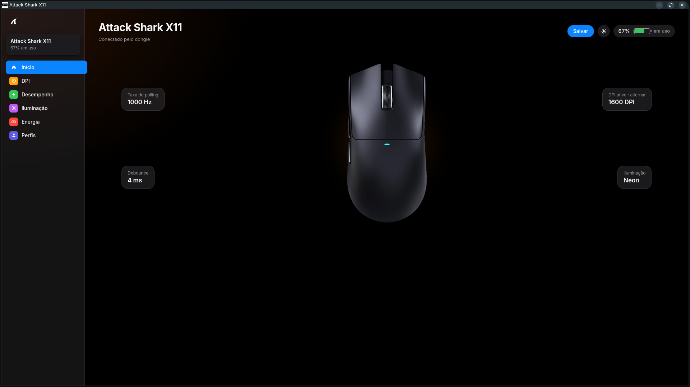

# Attack Shark X11 Control Panel for Linux

A modern, lightweight desktop panel to configure the **Attack Shark X11** mouse on Linux, with light and dark themes, profiles and live battery status.

[](https://www.python.org/)
[](https://www.kernel.org/)
[](https://github.com/D3m0nZOnFire/mousectl)
[](LICENSE)

 Add a screenshot of your own app here:
<p align="center"></p>


> **Disclaimer**
> This is an **unofficial**, community project. It is not affiliated with, sponsored by or endorsed by **Attack Shark**. Attack Shark and its logo are trademarks of their respective owner. Use this software at your own risk.

## Features

**DPI**
- Up to 8 stages, from 50 to 26,000 DPI, each with its own color and on/off switch.
- Switch the active stage with one click on the home screen.

**Performance**
- Polling rate: 125, 250, 500 or 1000 Hz.
- Debounce time, Angle Snap and Ripple Control.
- Read-only status for Motion Sync and Lift-Off Distance.

**Lighting**
- Modes: static, breathing, neon, color breathing and DPI-color modes.
- Color, brightness and effect speed.
- The glow behind the mouse on the home screen follows your LED color.

**Battery and power**
- Live battery percentage with a charging indicator.
- Idle sleep and deep sleep timers.

**Profiles**
- Save the current settings under a name (for example "Competitive FPS" or "Battery saver").
- Applying a profile only writes the values that changed, with a progress bar.

**Interface**
- Light and dark themes with an animated switch.
- Opens in its own app-style window, with a short intro animation.
- Friendly messages when the mouse is asleep or permissions are missing.

## How it works

1. **Backend:** `atk-linux.py` starts a small HTTP server on `127.0.0.1` (random token per session, never exposed to the network) and talks to the mouse through [`mousectl`](https://github.com/D3m0nZOnFire/mousectl).
2. **Frontend:** the UI is a single web page opened in a Chromium-based browser in `--app` mode, so it feels like a native app and uses very few resources. The server shuts down by itself when you close the window.

Only the standard Python library is used. No `pip install` needed.

## Requirements

- Linux with **Python 3.8+**
- **[mousectl](https://github.com/D3m0nZOnFire/mousectl)** installed and working
- A Chromium-based browser (Brave, Chrome or Chromium). Without one, the default browser is used.

## Installation

### 1. Install mousectl

```bash
sudo apt install git python3 pipx
git clone https://github.com/D3m0nZOnFire/mousectl
cd mousectl
./install.sh
```

Make sure `~/.local/bin` is in your `PATH`:

```bash
echo 'export PATH="$HOME/.local/bin:$PATH"' >> ~/.bashrc
```

Grant access to the mouse (see [Troubleshooting](#troubleshooting)), then check that it works:

```bash
mousectl status
```

### 2. Get the panel

```bash
git clone https://github.com/shiver00/attack-shark-x11-linux
cd attack-shark-x11-linux
```

### 3. Run it

Run once without installing anything:

```bash
python3 atk-linux.py
```

Or install a launcher in your application menu:

```bash
python3 atk-linux.py --instalar
```

Then open **Attack Shark X11** from the menu.

## Optional: logo and mouse image

The panel works without any images (it shows a text logo and a simple mouse drawing). To use your own, put these files next to `atk-linux.py` **before** running `--instalar`:

| File | Purpose |
| --- | --- |
| `atk-logo.svg` (or `.png`) | Logo in the sidebar and as app icon |
| `atk-logo-dark.svg` (or `.png`) | Optional light logo for dark mode. If missing, the normal logo is inverted to white |
| `atk-mouse.png` | Mouse picture on the home screen (transparent PNG works best) |

These files are not included in this repository, because they are the property of Attack Shark.

## Data and files

| Path | Content |
| --- | --- |
| `~/.config/atk-linux/profiles.json` | Your saved profiles |
| `~/.local/share/atk-linux/` | Logo and mouse images |
| `~/.local/bin/atk-linux` | Installed copy of the script |
| `~/.local/share/applications/atk-linux.desktop` | Menu launcher |

## Uninstall

```bash
rm -f ~/.local/bin/atk-linux ~/.local/share/applications/atk-linux.desktop
rm -rf ~/.local/share/atk-linux ~/.config/atk-linux
```

## Troubleshooting

**Permission denied when opening the mouse**

```bash
mousectl install-udev
```

Run the two `sudo` commands it prints, then unplug and replug the USB dongle or cable.

**The mouse does not respond**

The mouse sleeps to save battery. Move it or click a button, then press **Try again** in the panel.

**The window does not open**

Check that `python3 --version` is 3.8 or newer. If no Chromium-based browser is found, the panel opens in your default browser instead.

**Battery shows "in use" while charging**

The panel treats a wired connection below 100% as charging. If the mouse reports something else, open an issue with the output of `mousectl status --json`.

## Limitations

- Button remapping and macros are not available, because `mousectl` does not expose them for the X11.
- Developed and tested with the Attack Shark X11 on Zorin OS (Ubuntu-based). Other distributions should work but are untested.

## Credits

- [mousectl](https://github.com/D3m0nZOnFire/mousectl) by D3m0nZOnFire does all the communication with the mouse. This project is only a graphical layer on top of it.

## License

Distributed under the MIT License. See [LICENSE](LICENSE) for details.